# OrgPulse — Architecture

This document describes how OrgPulse is split into microservices, how they talk to each other, what data each one owns, and how the key flows work.

---

## 1. System Overview

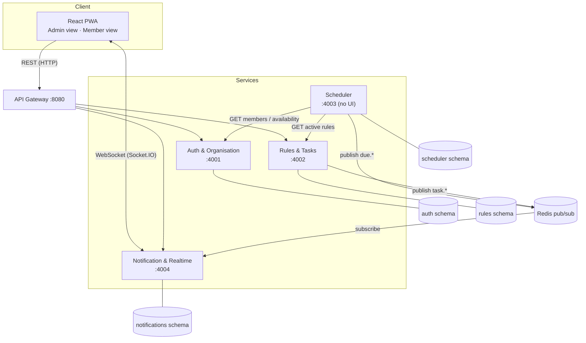

**Principles**

- **Database per service** — each service owns its own PostgreSQL schema; no service reads another service's tables.
- **Synchronous** calls (REST) for user actions that need an immediate answer.
- **Asynchronous** events (Redis pub/sub) for "something happened, whoever cares should react" — keeps services loosely coupled.
- **Stateless JWT** — the Gateway verifies the token once and forwards `userId`, `orgId` and `role` to services in headers.

---

## 2. Services

### 2.1 Auth & Organisation Service

| Owns | Exposes |
|---|---|
| Users, organisations, memberships, groups, roles, invite codes, unavailability periods | `POST /auth/register`, `POST /auth/login`, `GET /me` |
| | `POST /orgs`, `POST /orgs/join` (invite code), `GET /orgs/:id/members` |
| | `POST /orgs/:id/groups`, `PATCH /members/:id/role` |
| | `POST /me/unavailable` (e.g. on holiday 1–14 Dec) |

### 2.2 Rules & Tasks Service

| Owns | Exposes |
|---|---|
| Rules (birthday / rotation / task), rotation order, task instances and their status, swap requests | `POST /rules`, `GET /rules`, `PATCH /rules/:id` (edit, pause, resume) |
| | `GET /rules/preview?days=7` — what will fire in the next N days |
| | `GET /tasks/mine/upcoming`, `PATCH /tasks/:id/done` |
| | `POST /tasks/:id/swap`, `PATCH /swaps/:id` (accept / decline) |

Publishes: `task.completed`, `task.swapped`, `task.created`.

### 2.3 Scheduler Service

- Runs on a timer (every minute in dev; manual `POST /scheduler/run` for the demo).
- Asks Rules & Tasks for active rules and Auth & Org for members and their availability.
- Decides what is due and for whom — including **whose turn it is**, skipping anyone marked unavailable.
- Records what it has already fired (`fired_events`) so the same notification is never sent twice, even if it restarts.
- Publishes `due.birthday`, `due.task`, `due.reminder`.

### 2.4 Notification & Realtime Service

- Holds a Socket.IO connection per logged-in user; each user joins rooms `user:<id>` and `org:<id>`.
- Subscribes to Redis, stores each notification in history, then pushes it to the right room.
- Handles live interactions that originate on the socket: birthday wishes, read receipts.
- Respects each user's preferences (quiet hours, muted categories).

| Exposes | |
|---|---|
| REST | `GET /notifications?unread=true`, `PATCH /notifications/:id/read`, `PUT /preferences` |
| Socket events (server → client) | `notification:new`, `task:updated`, `wish:new` |
| Socket events (client → server) | `wish:send`, `notification:read` |

---

## 3. Event Contract (Redis channels)

| Channel | Publisher | Payload (simplified) | Who gets it |
|---|---|---|---|
| `due.birthday` | Scheduler | `{ orgId, memberId, memberName, date }` | Whole org (`org:<id>`) |
| `due.task` | Scheduler | `{ orgId, ruleId, taskId, assigneeIds[], title, dueAt }` | Assignees |
| `due.reminder` | Scheduler | `{ taskId, assigneeIds[], dueAt }` | Assignees (e.g. 24 h before a deadline) |
| `task.completed` | Rules & Tasks | `{ orgId, taskId, completedBy }` | Admins + task's group |
| `task.swapped` | Rules & Tasks | `{ taskId, fromId, toId }` | Both members + admins |

Every event carries an `eventId` so consumers can ignore duplicates (idempotency).

---

## 4. Key Flows

### 4.1 Rule fires → member is notified

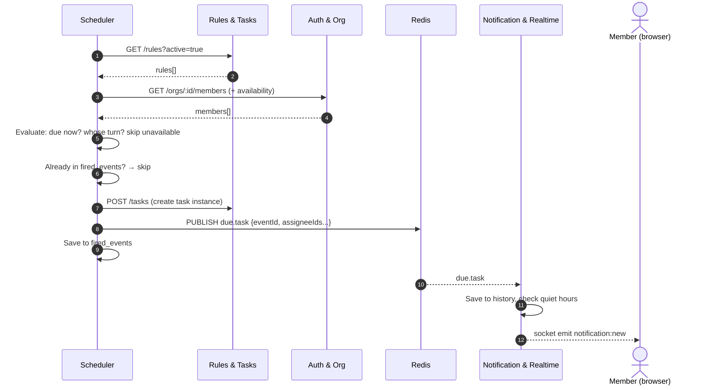

### 4.2 Member marks task "Done" → admin sees it live

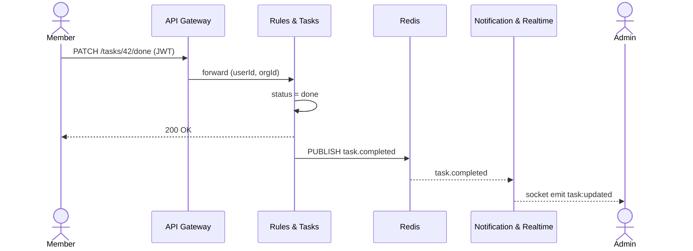

### 4.3 Duty swap

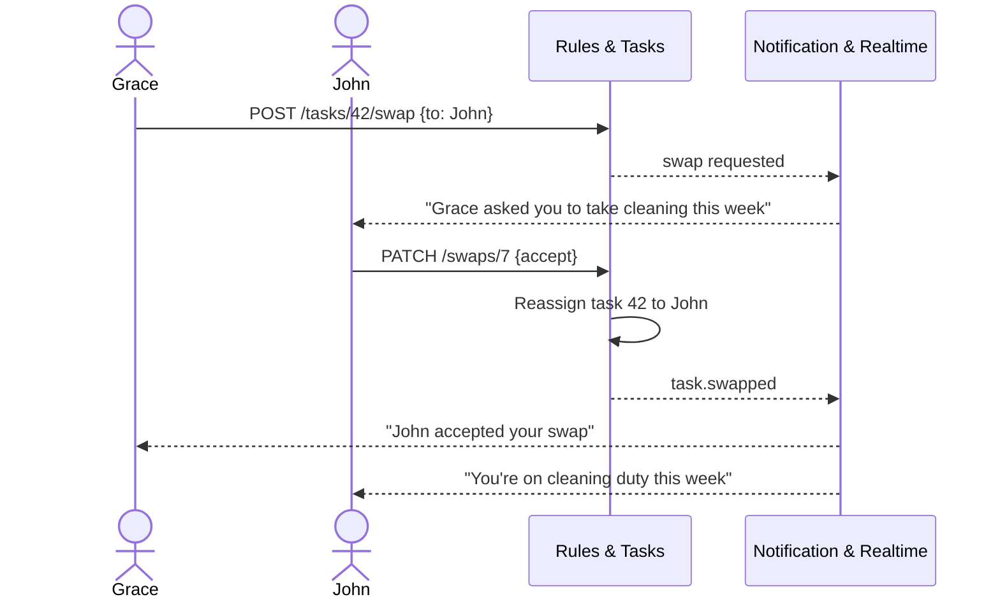

### 4.4 Birthday with live wishes

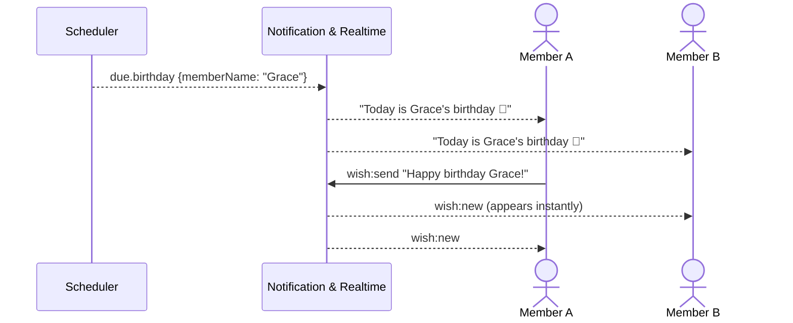

---

## 5. Task Lifecycle

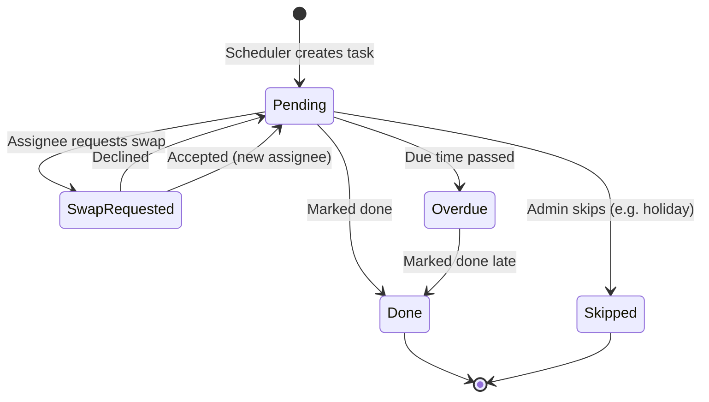

---

## 6. Data Model (one schema per service)

### 6.1 Auth & Organisation

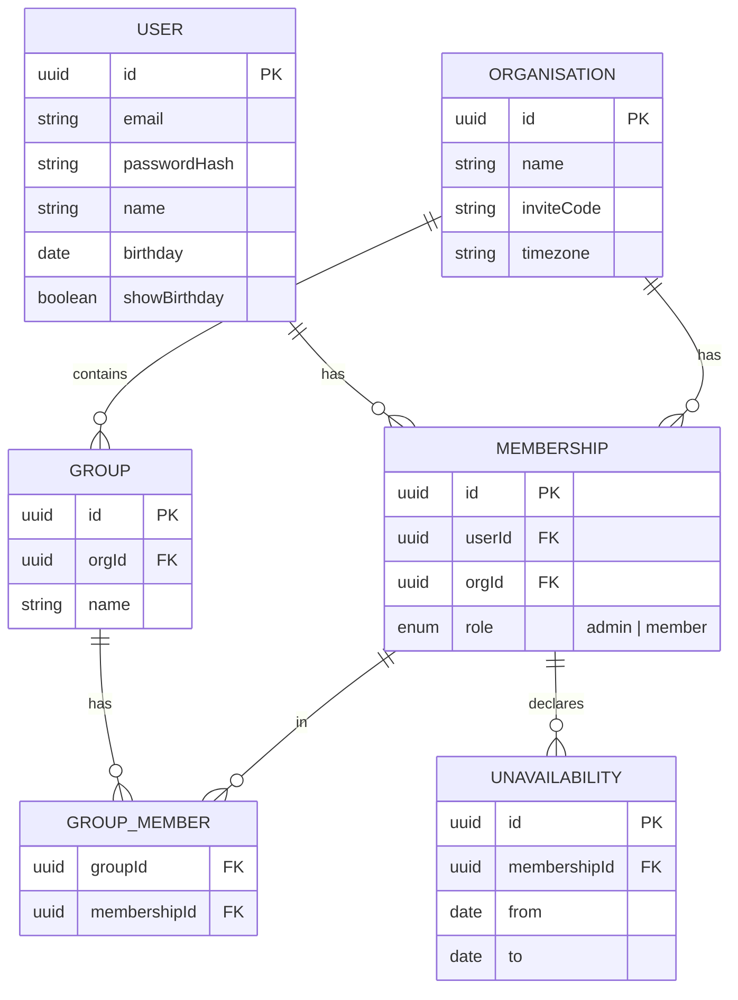

### 6.2 Rules & Tasks

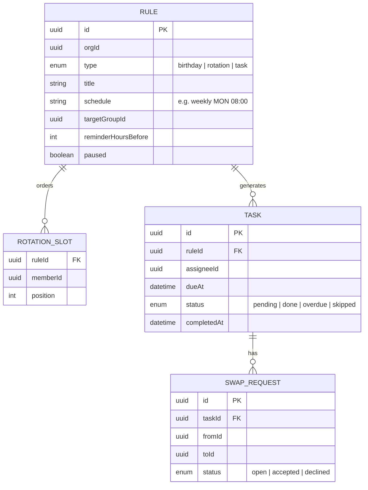

> `memberId`, `assigneeId` and `orgId` are plain IDs — not foreign keys — because users live in another service's database.

### 6.3 Scheduler

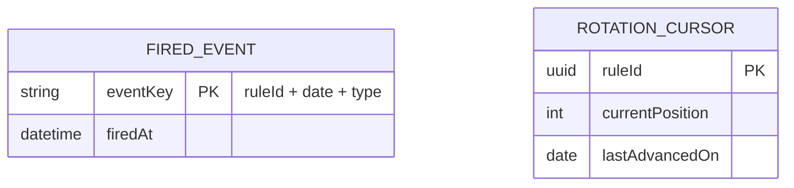

### 6.4 Notification & Realtime

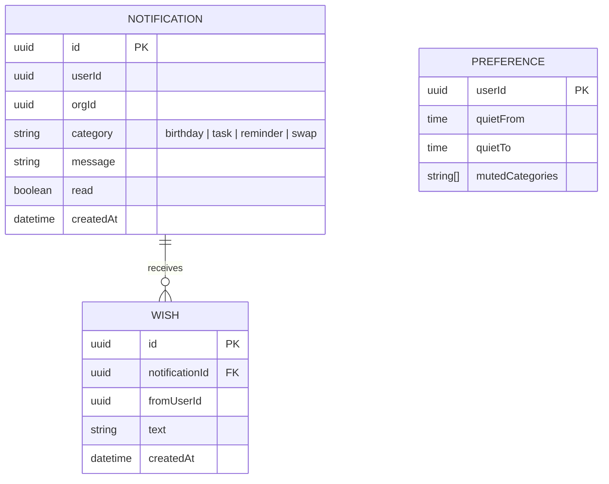

---

## 7. Deployment (Docker Compose)

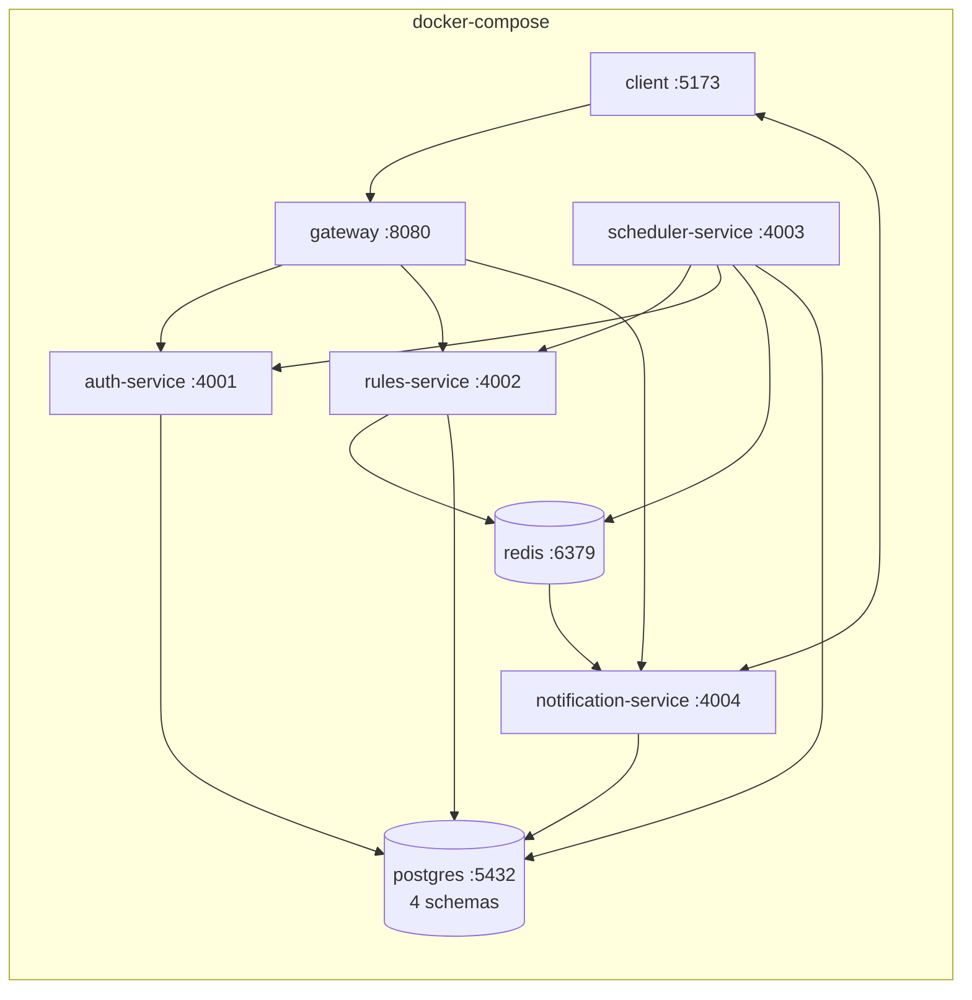

One command starts everything:

```bash
docker compose up --build
```

---

## 8. Design Decisions

| Decision | Why |
|---|---|
| Store rules, generate tasks on the fly | Keeps data small and the calendar clean; editing a rule changes all future occurrences |
| Scheduler is its own service | Time-based logic is isolated; can be scaled or restarted without touching user-facing services |
| Redis pub/sub between Scheduler and Notification | Scheduler doesn't need to know who is online or how messages are delivered |
| `fired_events` table | Prevents duplicate notifications after a restart (idempotency) |
| Socket.IO rooms per user and per org | One emit reaches exactly the right people |
| Organisation timezone | "Today" means today for the church, not for the server |
