# OrgPulse — Architecture

This document describes how OrgPulse is split into microservices, how they talk to each other, what data each one owns, and how the key flows work.

---

## 1. System Overview

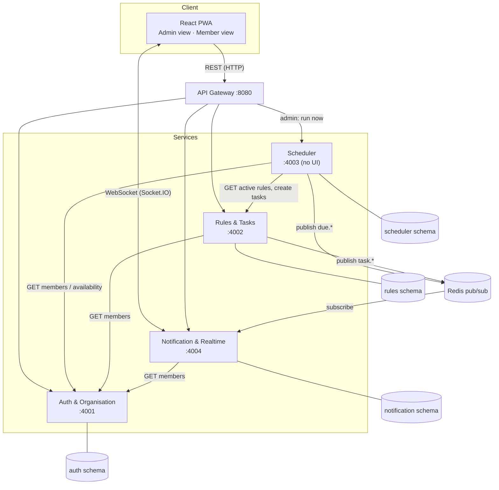

**Principles**

- **Database per service** — each service owns its own PostgreSQL schema; no service reads another service's tables.
- **Synchronous** calls (REST) for user actions that need an immediate answer.
- **Asynchronous** events (Redis pub/sub) for "something happened, whoever cares should react" — keeps services loosely coupled.
- **Stateless JWT** — the Gateway verifies the token once and forwards `userId`, `orgId` and `role` to services in headers. It removes those headers if a client sends them.
- **Internal routes** — services call each other directly on `/internal/*` with a shared `x-internal-key`. The gateway does not expose these routes.
- **One Socket.IO exception** — all REST traffic goes through the gateway. Only the live socket connects straight to the Notification service, which checks the token itself.

---

## 2. Services

### 2.1 Auth & Organisation Service

**Owns:** users, organisations, memberships, groups, roles, invite codes and unavailability periods.

- Registration, login and JWTs (valid for 7 days).
- Creating and joining organisations, members, roles and groups.
- Marking dates as unavailable.
- Internal routes that give other services members, timezones and availability.
- Checks memberships in its own database on each request, so a removed member is refused straight away.

### 2.2 Rules & Tasks Service

**Owns:** rules (birthday / rotation / task), rotation order, task instances and their status, and swap requests.

- Creating, editing, pausing, resuming and deleting rules, and skipping one occurrence.
- Previewing the next N days, without creating or sending anything.
- A member's tasks for today and the next 4 weeks, and marking tasks done.
- A status board for admins, and duty swaps.

Publishes: `task.completed`, `task.swap_requested`, `task.swapped`.

### 2.3 Scheduler Service

- Runs on a timer (`SCHEDULER_CRON`, every minute by default) when `SCHEDULER_ENABLED` is on. An admin can also run it for their own organisation with `POST /api/scheduler/run`.
- Asks Rules & Tasks for active rules and Auth & Org for members and their availability.
- Decides what is due and for whom — including **whose turn it is**, skipping anyone marked unavailable.
- Creates a task on its day, or earlier if its reminder is due first, so a reminder can arrive before the duty does.
- Records what it has already fired (`FiredEvent`) so the same notification is never sent twice, even if it restarts. If publishing fails, the record is removed and the next run tries again.
- Runs one job at a time, so the timer and the button cannot overlap.
- Publishes `due.birthday`, `due.task`, `due.reminder`.

### 2.4 Notification & Realtime Service

- Holds a Socket.IO connection per logged-in user; each user joins rooms `user:<id>` and `org:<id>`.
- Subscribes to Redis, stores each notification in history, then pushes it to the right room.
- Handles live interactions that originate on the socket: birthday wishes, read receipts.
- Respects each user's preferences (quiet hours, muted categories). Those notifications are saved but not pushed.

Every endpoint and socket event is listed in the [API Reference](api.md).

---

## 3. Event Contract (Redis channels)

| Channel | Publisher | Payload (simplified) | Who gets it |
|---|---|---|---|
| `due.birthday` | Scheduler | `{ orgId, memberId, memberName, date }` | Whole org |
| `due.task` | Scheduler | `{ orgId, ruleId, taskId, assigneeIds[], title, dueAt }` | Assignees, or admins if nobody is available |
| `due.reminder` | Scheduler | `{ orgId, taskId, assigneeIds[], title, dueAt }` | Assignees (e.g. 24 h before a deadline) |
| `task.completed` | Rules & Tasks | `{ orgId, taskId, title, completedBy, completedByName }` | Admins |
| `task.swap_requested` | Rules & Tasks | `{ orgId, swapId, taskId, title, fromId, fromName, toId }` | The person being asked |
| `task.swapped` | Rules & Tasks | `{ orgId, taskId, title, fromId, toId }` | Both members + admins |

Every event carries an `eventId` so consumers can ignore duplicates (idempotency).

---

## 4. Key Flows

### 4.1 Rule fires → member is notified

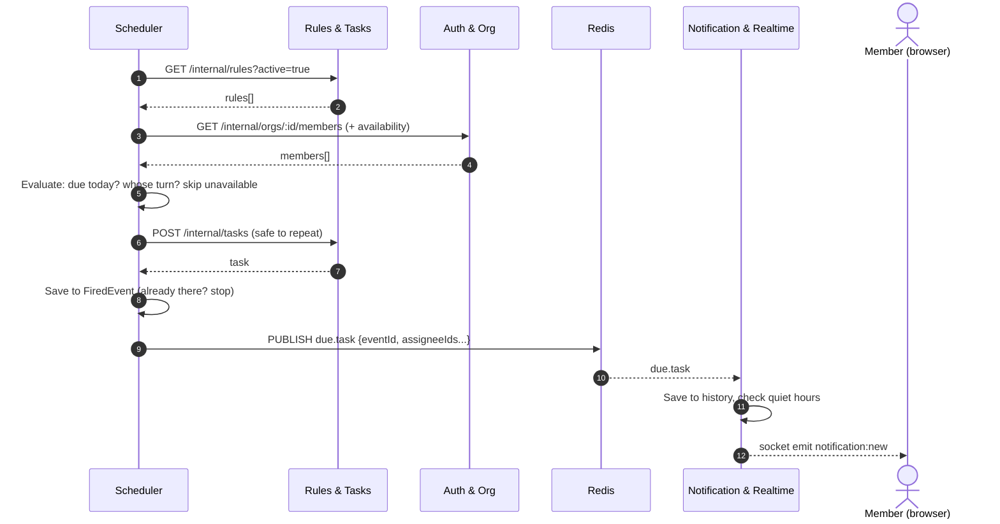

### 4.2 Member marks task "Done" → admin sees it live

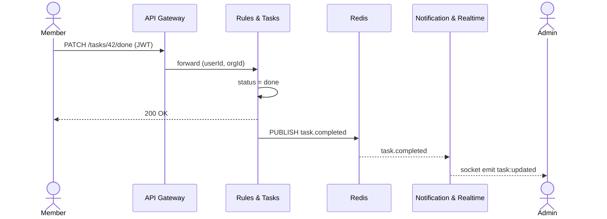

### 4.3 Duty swap

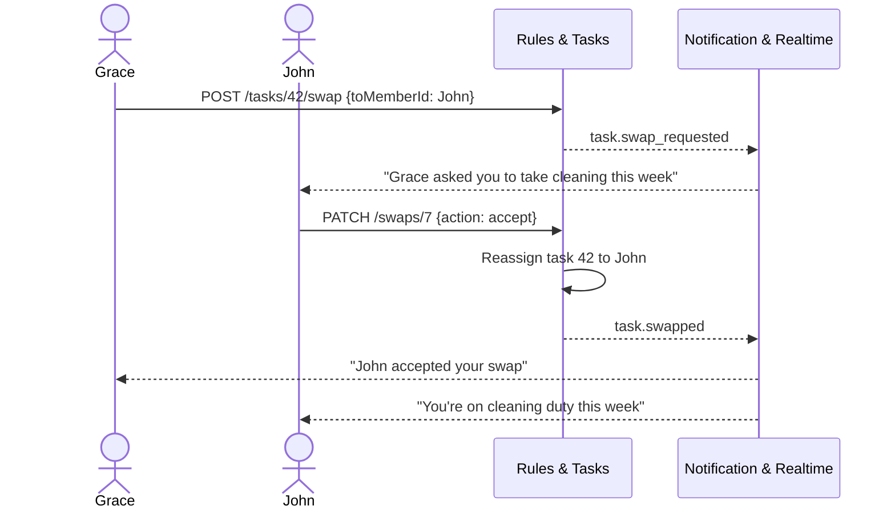

### 4.4 Birthday with live wishes

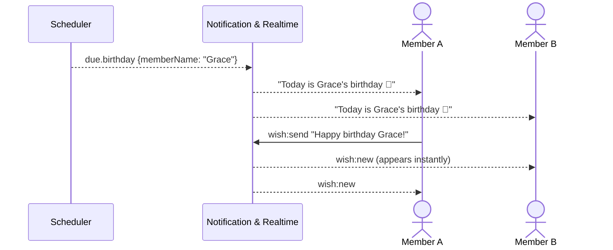

---

## 5. Task Lifecycle

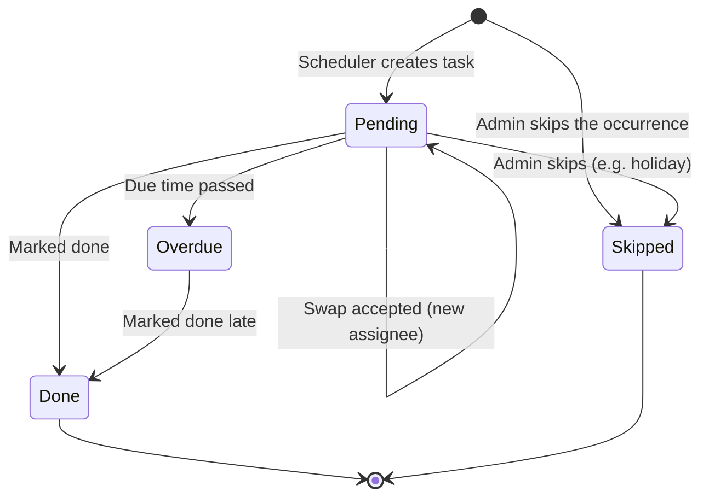

A swap request is stored separately, so the task stays pending while it waits for an answer.

---

## 6. Data Model (one schema per service)

### 6.1 Auth & Organisation

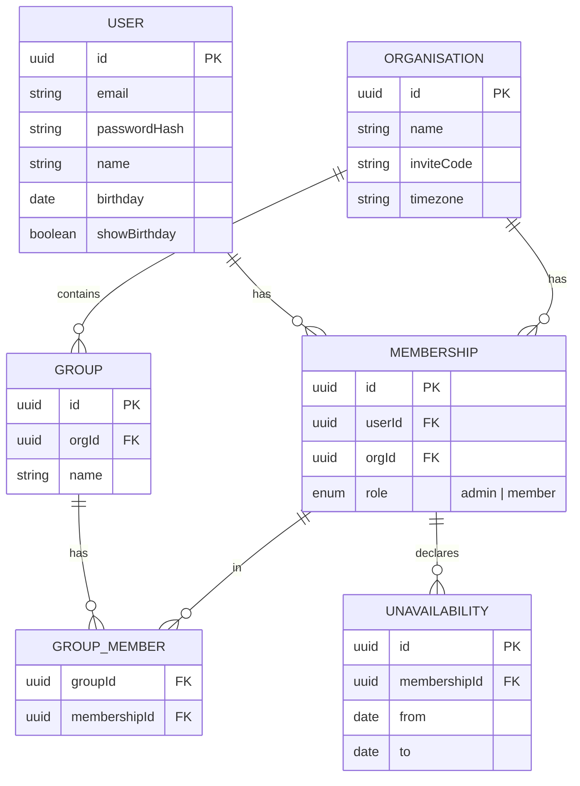

### 6.2 Rules & Tasks

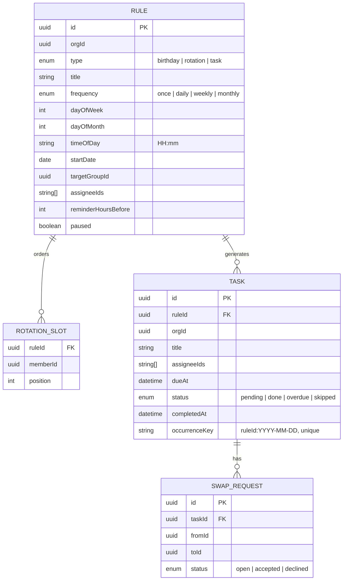

> A task has a list of assignees: one person for a rotation, several for a shared task, and nobody if the whole rotation was unavailable. Any assignee can complete a shared task, and that completes it for everyone.
>
> `memberId`, `assigneeIds` and `orgId` are plain IDs — not foreign keys — because users live in another service's database.

### 6.3 Scheduler

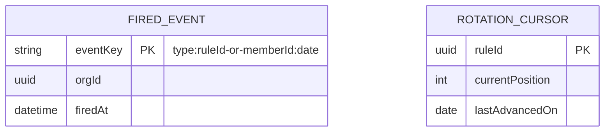

### 6.4 Notification & Realtime

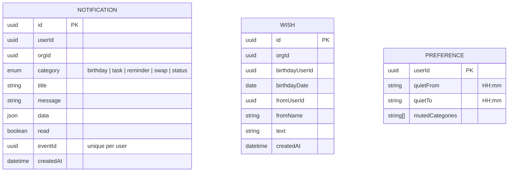

---

## 7. Deployment (Docker Compose)

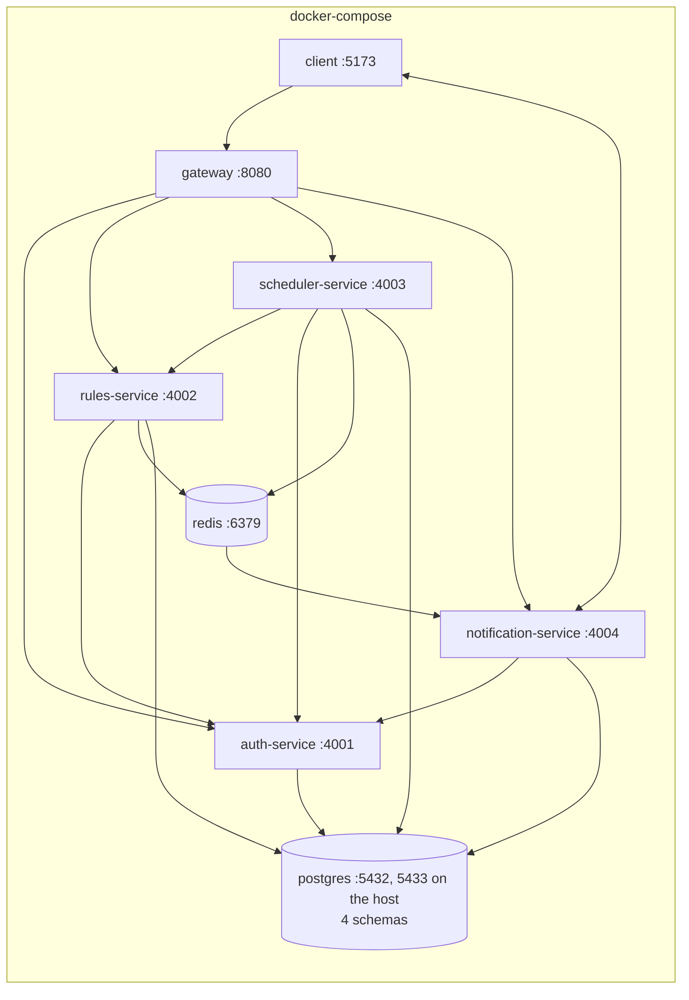

One command starts everything:

```bash
docker compose up --build
```

Each service applies its database migrations when it starts. The Scheduler's timer is off by default in Docker, so the "Run scheduler now" button is what fires events in the demo. `SCHEDULER_ENABLED=true docker compose up` turns it on.

---

## 8. Design Decisions

| Decision | Why |
|---|---|
| Store rules, generate tasks on the fly | Keeps data small and the calendar clean; editing a rule changes all future occurrences |
| Scheduler is its own service | Time-based logic is isolated; can be scaled or restarted without touching user-facing services |
| Redis pub/sub between Scheduler and Notification | Scheduler doesn't need to know who is online or how messages are delivered |
| `FiredEvent` table | Prevents duplicate notifications after a restart (idempotency) |
| Socket.IO rooms per user and per org | One emit reaches exactly the right people |
| Organisation timezone | "Today" means today for the church, not for the server |
| A task has a list of assignees | One due event can reach a whole choir, while a rotation simply has a list of one |
| Tasks can be created before their day | A reminder needs a task to point at, so the task is created when the reminder is due, and the duty is announced on its day |
| A rotation moves on by one per occurrence | A stand-in covers one turn, and everyone keeps their place in the order |
| The "Run scheduler now" button runs one organisation | One admin must not be able to trigger notifications for another organisation |

## 9. Known Limitations

| Limitation | Why it is acceptable for this project |
|---|---|
| Redis pub/sub does not store messages | An event published while the Notification service is down is lost. A message queue would fix this |
| Only Auth & Org checks membership on each request | Other services trust the token's role, so a removed or demoted user keeps that access there until the token is refreshed or expires |
| Duties are announced at the start of their day | `timeOfDay` is the deadline. Quiet hours can hold back the push |
| Tasks turning overdue have no event | The status board shows this after a refresh |
| Reordering a rotation keeps its position | The next turn goes to whoever is now at that position |
