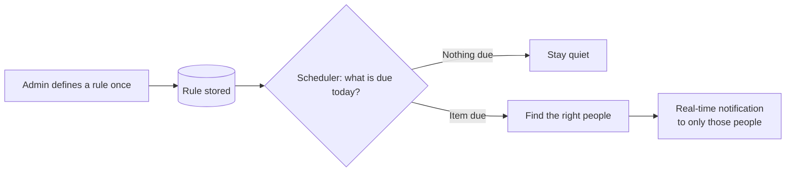
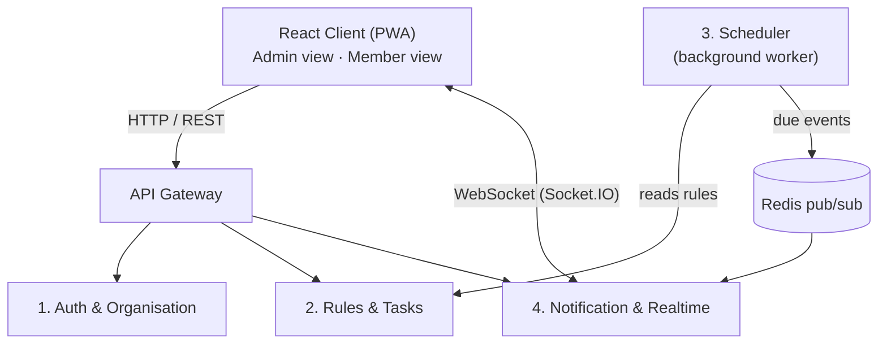
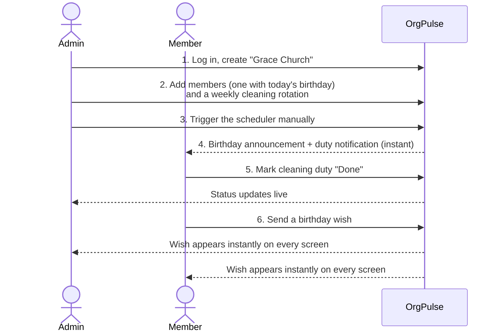

# OrgPulse — Project Proposal

**Smart Notifications for Organisations**

**Student:** Vivian Nyambura Murathimi
**Neptun code:** h1ckb0

---

## 1. The Problem

Organisations such as churches, clubs, schools and teams have recurring duties: birthdays, cleaning rotas, ushering rosters and class assignments. These usually end up as hundreds of calendar entries — one for every birthday, every rotation, every week. The calendar becomes cluttered and people start ignoring it.

## 2. The Idea

**OrgPulse stores rules instead of calendar entries.**

- An admin defines a rule once, e.g. *"announce each member's birthday on their day"* or *"rotate cleaning duty weekly between these 5 people"*.
- The system works out what is due today and for whom.
- Only the relevant people receive a real-time notification, at the moment it matters.

**Result:** the calendar stays clean and tasks are managed automatically.

## 3. Example Use Cases

| Organisation | Rule | What happens |
|---|---|---|
| Church | Member birthdays | On the day, everyone is notified ("Today is Grace's birthday") and can send live wishes |
| Organisation | Rotational tasks | Each week the next person in the rota is notified: "You're on cleaning duty this week" |
| School / class | Assignments and deadlines | Students are notified when a task is set and reminded before it is due |

A fuller list of what admins and members can do is in [User Stories & Features](user-stories.md).

## 4. Architecture at a Glance

Four microservices, one API Gateway and one React client. Full details, data models and sequence diagrams are in [Architecture](architecture.md).

| # | Service | Responsibility |
|---|---|---|
| 1 | Auth & Organisation | Registration/login (JWT); organisations, members, groups, roles |
| 2 | Rules & Tasks | Stores rules (birthdays, rotations, tasks), rotation order, task status |
| 3 | Scheduler | Timer-based worker; evaluates rules and publishes "due" events. No UI |
| 4 | Notification & Realtime | WebSocket connections, pushes notifications, live wishes and "Done" updates, history |
| — | API Gateway | Single entry point; routes requests (infrastructure, not counted as a service) |
| — | React Client | Admin view and member feed |

## 5. Real-Time Communication

| Event | Real-time behaviour |
|---|---|
| Task becomes due | Notification appears instantly for the assigned person |
| Birthday | Announcement goes to the whole organisation; wishes appear live |
| Task marked "Done" | Admin and group see the status change without refreshing |
| Rotation advances | The next person is notified immediately |
| Duty swap accepted | Both people and the admin see the new assignment instantly |

## 6. Tech Stack

| Layer | Technology |
|---|---|
| Client | React + TypeScript + Vite (PWA) |
| Services | Node.js + Express + TypeScript |
| Database | PostgreSQL with Prisma, one schema per service |
| Real-time | Socket.IO |
| Messaging | Redis pub/sub |
| Deployment | Docker Compose (whole system starts with one command) |

## 7. Demo Plan (about 3 minutes)

1. Admin logs in and creates the organisation "Grace Church" (Auth & Org).
2. Admin adds members — one with today's birthday — and creates a weekly cleaning rotation (Rules & Tasks).
3. Admin triggers the scheduler manually (Scheduler).
4. In a second browser window, a member instantly sees the birthday announcement and their duty notification (Notification, real-time).
5. The member marks the task "Done"; the admin's screen updates live.
6. Someone sends a birthday wish; it appears instantly on every screen.

## 8. Scope

**In scope (MVP)**
- Three rule types: birthdays, rotations, tasks
- In-app real-time notifications
- Admin and member views
- Join an organisation with an invite code
- "My upcoming duties" list and "Mark unavailable" so rotations skip absent people
- Admin preview of what will fire this week

**Future work**
- Duty swap requests between members
- Email / web push notifications
- Optional calendar export for important items only
- Analytics such as task completion rates
- Escalation of overdue tasks to the admin

See [User Stories & Features](user-stories.md) for the full prioritised list.

---

> **In one line:** We store rules, not calendar entries. The system decides what is relevant today and delivers it in real time to only the right people.
