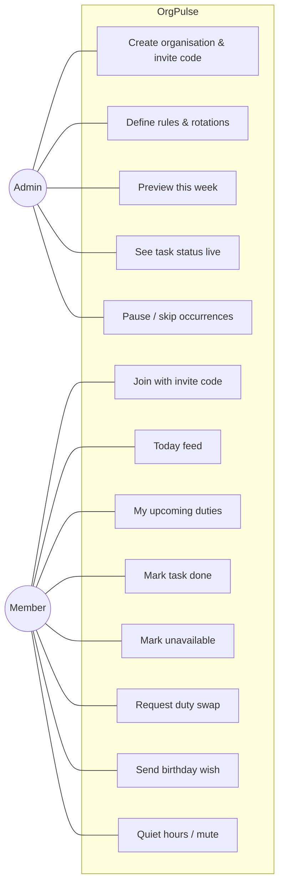
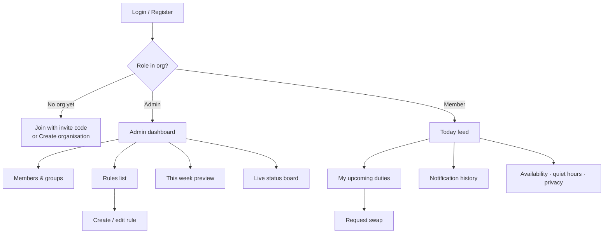

# OrgPulse — User Stories & Features

Written from the point of view of the people who would actually use OrgPulse. Each feature is tagged:

- **MVP** — built for the course demo
- **Should** — build if time allows
- **Future** — documented, not built

---

## 1. Who uses it

| Persona | Example | What they want |
|---|---|---|
| **Admin** | Church secretary, club coordinator, class teacher | Set things up once and stop chasing people |
| **Member** | Church member, club member, student | Only hear about things that concern *them*, at the right time |

---

## 2. Admin stories

| # | As an admin, I want to… | So that… | Priority |
|---|---|---|---|
| A1 | create an organisation and get an **invite code / link** | members can join themselves instead of me typing everyone in | MVP |
| A2 | add members and organise them into **groups** (e.g. Ushers, Choir, Class 3B) | rules can target a group, not the whole organisation | MVP |
| A3 | create a **birthday rule** once for the whole organisation | every birthday is announced without hundreds of calendar entries | MVP |
| A4 | create a **rotation** (people + order + frequency) | the next person is told automatically each week | MVP |
| A5 | create a **one-off or recurring task** with a deadline and a reminder (e.g. 24 h before) | people are reminded before it's too late | MVP |
| A6 | see a **live status board** (pending / done / overdue) | I know what's been done without asking around | MVP |
| A7 | **preview what will fire in the next 7 days** | I can check a new rule is right before anyone gets notified | MVP |
| A8 | **pause** a rule or **skip** one occurrence (e.g. Christmas week) | the system doesn't nag people during holidays | Should |
| A9 | **reorder** a rotation or remove someone who left | the rota stays correct without recreating the rule | Should |
| A10 | get alerted when a task becomes **overdue** | I can step in before it's forgotten | Should |
| A11 | **promote** another member to admin | I'm not the single point of failure | Should |
| A12 | see **completion stats** (who does their duties, on time %) | I can recognise reliable people and fix problems | Future |
| A13 | **export important items only** to a calendar (.ics) | key dates (e.g. annual meeting) still appear in calendars | Future |

## 3. Member stories

| # | As a member, I want to… | So that… | Priority |
|---|---|---|---|
| M1 | **join** an organisation with an invite code | getting started takes seconds | MVP |
| M2 | see a **Today feed** with only what concerns me | I'm not overwhelmed and I actually read it | MVP |
| M3 | get a **real-time notification** when it's my turn | I don't have to check a rota sheet | MVP |
| M4 | **mark my task done** with one tap | the admin knows without me messaging them | MVP |
| M5 | see **"My upcoming duties"** for the next few weeks | I can plan ahead — without a cluttered calendar | MVP |
| M6 | **send a birthday wish** that everyone sees live | birthdays feel like a community moment | MVP |
| M7 | **mark myself unavailable** for dates (travel, exams) | the rotation skips me and goes to the next person | MVP |
| M8 | **request a swap** with another member | I can sort out clashes myself without bothering the admin | Should |
| M9 | set **quiet hours** and **mute** categories (e.g. birthdays) | I'm not disturbed at night or by things I don't care about | Should |
| M10 | choose whether my **birthday is shown** (and hide my birth year) | I keep control of my privacy | Should |
| M11 | see a **notification history** and an unread badge | I can catch up after being offline | MVP |
| M12 | get **push / email** notifications when the app is closed | I don't miss my duty if I don't open the app | Future |
| M13 | be a member of **several organisations** (church + club) with one account | everything is in one place | Future |

---

## 4. Acceptance criteria (MVP highlights)

**M7 — Mark unavailable**
- Given I am marked unavailable from 1–14 Dec,
- when the cleaning rotation reaches my turn on 5 Dec,
- then the next available person is notified instead, and I am *not* skipped permanently — I keep my place for the following turn.

**A7 — Preview the week**
- Given an admin opens the preview,
- then they see a list of every notification that would be sent in the next 7 days (what, who, when),
- and nothing is actually sent.

**M4 — Mark done**
- When a member taps "Done", the admin's status board updates within 1 second without refreshing.
- A task cannot be marked done by someone who is not its assignee or an admin.

**Scheduler — no duplicates**
- If the scheduler runs twice for the same day (e.g. restart), each person still receives each notification only once.

---

## 5. Edge cases we thought about

| Situation | How OrgPulse handles it |
|---|---|
| Birthday on 29 February | Announced on 28 February in non-leap years |
| Everyone in a rotation is unavailable | Task created unassigned; admin is alerted |
| Member leaves the organisation | Removed from future rotations; past history kept |
| Member offline when notification fires | Stored in history; shown with unread badge on next login |
| Admin edits a rule mid-week | Affects future occurrences only; already-created tasks stay |
| Organisation in a different timezone than the server | "Today" is computed in the organisation's timezone |
| Two admins edit the same rule at once | Last write wins; the change is pushed live to the other admin |

---

## 6. Screens (client)

